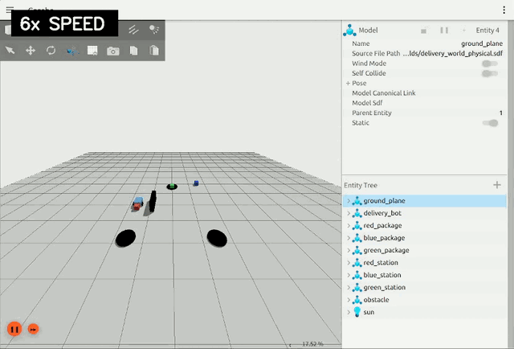
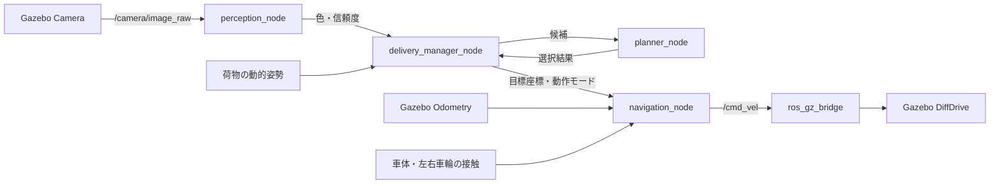

# AI宅配ロボット

ROS 2 HumbleとGazebo Fortress上で、カメラ画像から色付き荷物を認識し、
配送対象を選択して、差動二輪ロボットが対応するステーションまで物理的に押して運ぶ。
認識・意思決定・走行制御・物理接触は、4つのROS 2ノードに分けて実装している。



> デモ映像は6倍速で再生。

## 主な機能

- 学習済みRandom Forestによる赤・緑・青の荷物認識
- 推論信頼度・優先度・距離による配送対象の選択
- 差動二輪ロボットによる動的な箱の物理押送
- 荷物位置を使った配送完了判定と押送経路の再計算
- 既知障害物を避けるクリアランスウェイポイント
- 車体・左右車輪の接触検知と、後退・旋回による復帰
- 正常時の連続押送と、横ずれ時の再整列

## システム構成



| コンポーネント | 役割 |
|---|---|
| `perception_node` | 画像中の彩度領域を抽出し、学習済みモデルで色と信頼度を推論 |
| `planner_node` | 未配送荷物をスコアリングし、次の配送対象を選択 |
| `delivery_manager_node` | 荷物位置、配送状態、押送区間、完了判定を管理 |
| `navigation_node` | オドメトリによる目標追従と、接触時の復帰制御 |
| `ros_gz_bridge` | ROS 2とGazebo間でTwist、Odometry、Image、Contacts、Poseを変換 |

## AIによる認識と配送対象選択

色分類器はOpenCVのRandom Forest（`cv2.ml.RTrees`）で構築している。学習には、
Gazebo内の照明変化を想定して生成した赤・緑・青各600件の合成HSVデータを使用。
色相の循環を扱えるよう、HSV値を次の4特徴量へ変換する。

```text
cos(H), sin(H), S / 255, V / 255
```

推論結果は、次のスコアを通じて配送順へ反映される。

```text
score = 2.0 × priority + 1.5 × confidence - 0.8 × distance
```

画像に荷物が映っていない場合も、既知の未配送荷物を信頼度0.2の候補として保持。
一方、障害物回避、押送、接触復帰には、挙動を調整しやすいルールベース制御を採用した。

## 必要環境

- Ubuntu 22.04
- ROS 2 Humble
- Gazebo Fortress（Ignition Gazebo 6）
- `ros_gz_sim`、`ros_gz_bridge`、`ros_gz_interfaces`
- Python 3、OpenCV、NumPy、`cv_bridge`

## インストールとビルド

リポジトリをROS 2ワークスペースの`src`以下へ配置し、依存関係の解決後にビルドする。

```bash
mkdir -p ~/delivery_ws/src
cd ~/delivery_ws/src
git clone https://github.com/Tsuyo314/ai_delivery_robot.git

source /opt/ros/humble/setup.bash
cd ~/delivery_ws
rosdep install --from-paths src --ignore-src -r -y
colcon build --symlink-install
source install/setup.bash
```

## 起動方法

### 物理配送モード

動的な箱を実際に押して運ぶ、本プロジェクトのメインモード。

```bash
source /opt/ros/humble/setup.bash
source ~/delivery_ws/install/setup.bash
ros2 launch ai_delivery_robot delivery.launch.py physical_delivery:=true
```

### 仮想配送モード

静的な荷物を使った、ノード間連携の簡易確認用モード。

```bash
source /opt/ros/humble/setup.bash
source ~/delivery_ws/install/setup.bash
ros2 launch ai_delivery_robot delivery.launch.py
```

## 物理配送の流れ

```text
探索・AI選択
  → 必要なら障害物回避点
  → 箱の側方待機点
  → 箱から離れた整列点
  → 箱の真後ろ
  → 区間押送
  → 荷物位置の再確認
  → 連続押送または再整列
  → 配送先付近でX/Y微調整
  → 配送完了
  → 後退して離脱
```

配送完了の基準は、ロボット自身の到着ではない。Gazeboから取得した荷物中心が、
配送先中心から0.18 m以内に入った時点で完了と判定する。

## 主なパラメータ

主な調整値は`config/delivery.yaml`にまとめている。

| パラメータ | 初期値 | 内容 |
|---|---:|---|
| `normal_speed` | 0.90 m/s | 通常走行の上限 |
| `approach_speed` | 0.70 m/s | 回り込み・接近時の上限 |
| `push_speed` | 0.28 m/s | 押送時の上限 |
| `reverse_speed` | 0.45 m/s | 通常後退時の上限 |
| `package_staging_offset` | 0.85 m | 箱から側方待機点までの距離 |
| `package_alignment_offset` | 0.70 m | 真後ろよりさらに離れた整列距離 |
| `max_push_step` | 1.20 m | 1区間の最大押送距離 |
| `fine_adjust_radius` | 0.55 m | X/Y微調整を開始する距離 |
| `route_clearance` | 0.40 m | 障害物回避の安全余裕 |

## 動作確認

別端末でワークスペースをsourceすると、topicと内部状態を確認できる。

```bash
source /opt/ros/humble/setup.bash
source ~/delivery_ws/install/setup.bash

ros2 topic info /cmd_vel -v
ros2 topic echo /delivery/perception
ros2 topic echo /delivery/decision
ros2 topic echo /delivery/target_pose
ros2 topic echo /delivery/status
ros2 topic echo /bumper/left_wheel
ros2 topic echo /bumper/right_wheel
```

配送が進むと`/delivery/status`の`remaining`が減少する。全配送後に`state`が
`completed`へ変われば、シーケンス完了となる。

## モデルの再学習

同梱モデルは、固定シードを使って同じ条件で再学習できる。

```bash
ros2 run ai_delivery_robot train_color_model --output /tmp/color_classifier.yml
```

生成したモデルへ切り替えるには、`perception_node`の`color_model_path`パラメータへ
ファイルパスを渡す。

## ファイル構成

| パス | 内容 |
|---|---|
| `ai_delivery_robot/color_model.py` | 特徴量生成、Random Forest学習・推論 |
| `ai_delivery_robot/perception_node.py` | カメラ画像認識 |
| `ai_delivery_robot/planner_node.py` | 配送対象スコアリング |
| `ai_delivery_robot/delivery_manager_node.py` | 配送状態機械と押送計画 |
| `ai_delivery_robot/navigation_node.py` | 目標追従と接触復帰 |
| `models/delivery_bot/model.sdf` | 車体、車輪、カメラ、接触センサー、DiffDrive |
| `worlds/delivery_world_physical.sdf` | 動的荷物を使う物理配送ワールド |
| `worlds/delivery_world.sdf` | 簡易確認用の仮想配送ワールド |
| `config/delivery.yaml` | 荷物、障害物、速度、復帰動作の設定 |
| `launch/delivery.launch.py` | Gazebo、bridge、全ノードの一括起動 |
| `docs/demo.gif` | 物理配送の短いデモ |

## 既知の制約

- 色モデルの学習データは、実画像ではなくGazeboの照明変動を想定した合成HSV値
- 地図生成やNav2は使わず、既知障害物と接触復帰を組み合わせた構成
- 箱を把持するアームは搭載せず、車体で後方から押す方式
- 接触や横滑りによって変動する配送時間と経路

Copyright © 2026 Tsuyo314. All rights reserved.
